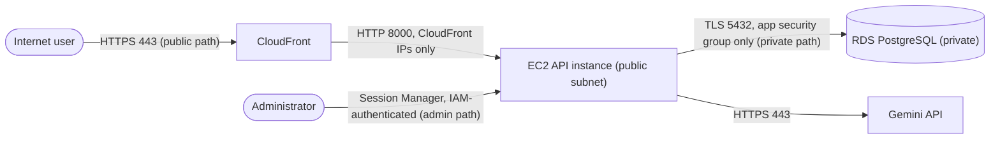
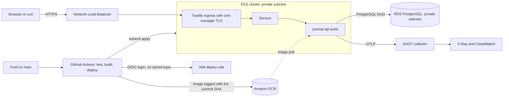

# Learn to Cloud Phase 3 Capstone: Journal API

[](https://github.com/Amarajah/journal-starter/actions/workflows/ci.yml)

Welcome to [Learn to Cloud's](https://learntocloud.com) Phase 3 capstone. You will be guided to building a journal API with **FastAPI**, **PostgreSQL**, structured logging, input validation, and AI-powered entry analysis.

## Capstone

These chapters will guide you and are meant to be completed in order. Each chapter builds on the previous one, so do not skip ahead. 

1. [Check the prerequisites](docs/01-prerequisites.md)
2. [Set up the project](docs/02-project-setup.md)
3. [Run the API](docs/03-run-the-api.md)
4. [Build GET for one entry](docs/04-get-entry.md)
5. [Build DELETE for one entry](docs/05-delete-entry.md)
6. [Add input validation and debug a partial update](docs/06-input-validation.md)
7. [Use logs to understand the API](docs/07-logging.md)
8. [Set up an AI provider](docs/08-ai-setup.md)
9. [Build AI-powered analysis](docs/09-ai-analysis.md)
10. [Finish the capstone](docs/10-finish.md)

**[Start the capstone →](docs/01-prerequisites.md)**

## Reference

This is additional reference material for the capstone in case you want to explore further or need help:

- [Testing and CI](docs/reference/testing-and-ci.md)
- [Troubleshooting](docs/reference/troubleshooting.md)
- [Sync your fork with upstream](docs/reference/upstream-sync.md)
- [Explore your database](docs/reference/explore-database.md)

> **Learning environment only:** This application has no authentication or
> per-user data isolation. Do not expose it publicly or store personal or
> sensitive journal content in it.

## License

MIT License - see [LICENSE](LICENSE).


## Phase 4 Capstone: Secure Cloud Deployment (AWS, eu-north-1)

**Public API:** https://d8wxgz3mcqe8i.cloudfront.net
The Journal API has no user authentication or data isolation, so only test data is used.

### Architecture



### Services chosen

| Layer | Service | Why |
|---|---|---|
| Front door | CloudFront (default `*.cloudfront.net` certificate) | Trusted HTTPS without owning a domain |
| App tier | EC2 running uvicorn as a `systemd` service under a dedicated `journalapp` user | Restarts on crash and at boot |
| Database | RDS PostgreSQL (`databasecapstone`), not publicly accessible | Private tier |
| AI | Gemini API through Google's OpenAI-compatible endpoint | Free tier |
| Admin access | AWS Systems Manager Session Manager | No SSH or open management port |
| Cost control | AWS Budgets | Alert before overspending |

### Access controls

- **Database:** only the app's security group can reach port 5432. The app connects as `journal_app`, which has no superuser, create-database or create-role attributes, no `CREATE` on schema `public`, and only `SELECT/INSERT/UPDATE/DELETE` on `entries`. Tables are owned by the admin user, and `CONNECT` on `career_journal` is revoked from `PUBLIC`. Connections use TLS.
- **Secrets:** the database URL and API key live in `/etc/journal-api.env` (root-owned, mode 600), loaded by `systemd`. They are not in the repo.
- **Admin:** Session Manager only. No SSH key and no inbound port 22.

### AI model and safety controls

- **Model:** `gemini-flash-lite-latest` (an alias that Google can repoint; verified 26 Oct 2026). API key authentication.
- **Endpoint:** Chat Completions on Google's compatibility endpoint. The course specifies the Responses API, but `POST /v1beta/openai/responses` returned 404 with a valid key and model on 26 Oct 2026, so `llm_service.py` was switched to Chat Completions (on branch gemini-chat-completions).
- **Timeout and retries:** 60 s total and 5 s connect timeout, one SDK retry. Failures propagate with no fallback analysis.
- **Safety:** the prompt tells the model to treat entry text as data, never as instructions. Output must match a strict JSON schema with `sentiment` limited to three values. Refusals, incomplete and blank responses are rejected, and the result is validated by `AnalysisResponse`. Error logs record entry id, error type and code location, not entry text.
- **Limits and cost:** Google Gemini's free tier

**Model comparison (from the API instance, small sample):**

| Model | Result |
|---|---|
| `gemini-flash-lite-latest` | 3/3 requests returned 200 in 0.57 to 0.79 s |
| `gemini-3.8-flash` | One request returned 503 after about 6 s, another got no response in 30 s, and the app logged `APITimeoutError` |

### Evidence per constraint

| # | Constraint | Evidence |
|---|---|---|
| 1 | Public HTTPS, trusted certificate | The course verifier passed on the CloudFront URL (entry creation and live analysis). Responses arrive as `HTTP/2` from CloudFront. |
| 2 | Private database | From the app instance the RDS name resolves to a private 10.x address and a TLS 1.2 connection succeeds. `\du`: `journal_app` has no attributes and no role memberships. `\dp entries`: `journal_app=arwd/postgres`. `\dn+ public`: `journal_app=U` (no CREATE). On laptop `nc -vz -w 5 <rds-endpoint> 5432` timeout; app-role `DROP TABLE` / `CREATE TABLE` denials |
| 3 | Private management, no secrets in git or logs | Admin access is via Session Manager only. Laptop timeouts on port 22 and on direct `:8000`; MFA enabled; `git log --all -p -S"AIza" --oneline` returns nothing |
| 4 | Survives restarts | Service runs under `systemd` with `Restart=always`, enabled at boot; data lives in RDS. |
| 5 | CRUD and live AI | Analysis passed the course verifier against the live model. Update and delete through the public URL |

### Limitation I would fix before pushing to production

**Model availability.** On the free tier, `gemini-3.8-flash` stalled or returned 503 while the lighter model answered in under a second. The verifier makes one unretried call with a 30 s limit, so a transient failure fails the request. For production I would use a paid tier or a second-model fallback, plus a hard application timeout shorter than the front door's 30 s limit so failures return quickly. Smaller gaps: CloudFront reaches the instance over plain HTTP (a custom origin secret header and encryption on that hop would help), and secrets sit in a root-only file instead of Secrets Manager.

### Cleanup

EC2 and RDS are stopped between work sessions and kept for Phase 5. Billing dashboard are also checked for any unexpected charges.

## Phase 5: Journal API: deployment guide

The Journal API (FastAPI + PostgreSQL) now runs on Amazon EKS. Infrastructure is defined in Terraform, and every push to `main` is tested, built into a container image, and deployed by GitHub Actions without any long-lived cloud credentials.

All commands assume region `eu-north-1`. Replace anything in `<angle brackets>` with your own value. Never commit secrets, `.env*` files, Terraform state or `*.tfvars`.

## 1. Architecture



| Component | Purpose |
|---|---|
| **GitHub Actions** | Runs `test`, `build` and `deploy` on pushes to `main` |
| **Amazon ECR** | Stores images, each tagged with the full commit SHA |
| **Amazon EKS** | Runs the API (two replicas) on managed nodes in private subnets |
| **Traefik + cert-manager** | Public HTTPS entry point with a Let's Encrypt certificate |
| **Amazon RDS (PostgreSQL 15)** | Database in private subnets, reachable only from the cluster's nodes. The master password is generated by AWS and stored in Secrets Manager |
| **Terraform** | Provisions the VPC, EKS, ECR, RDS and IAM. State lives in a versioned S3 bucket |
| **OpenTelemetry** | Traces, metrics and logs exported to AWS through an ADOT collector |

## 2. Repository layout

| Path | Contents |
|---|---|
| `api/` | Application code (`/version` returns the commit it was built from) |
| `Dockerfile`, `.dockerignore` | Image build; secrets and tooling are excluded from the image |
| `infra/` | Terraform: `network.tf`, `eks.tf`, `ecr.tf`, `rds.tf`, `iam.tf`, `versions.tf`, `variables.tf` |
| `k8s/` | Deployment, Service, Ingress, database init Job, Kustomization |
| `k8s/bootstrap/` | One-time cluster setup: Traefik values and cert-manager issuers |
| `.github/workflows/ci.yml` | The pipeline |
| `database_setup.sql` | Schema, safe to run repeatedly (`IF NOT EXISTS`) |

## 3. Prerequisites

- An AWS account and the AWS CLI configured with IAM permission to create the resources above (`aws sts get-caller-identity` should show your identity)
- Terraform **1.11 or newer** (the S3 backend uses native state locking)
- `kubectl`, `helm`, the GitHub CLI (`gh auth login`), Docker and `uv`
- A GitHub repository with Actions enabled

## 4. Provision the infrastructure

### 4.1 Create the Terraform state bucket (once, by hand)

The backend must exist before `terraform init`, so it is not managed by Terraform itself.

```bash
export BUCKET=<globally-unique-bucket-name>

aws s3api create-bucket --bucket "$BUCKET" --region eu-north-1 \
  --create-bucket-configuration LocationConstraint=eu-north-1
aws s3api put-bucket-versioning --bucket "$BUCKET" --versioning-configuration Status=Enabled
aws s3api put-bucket-encryption --bucket "$BUCKET" \
  --server-side-encryption-configuration '{"Rules":[{"ApplyServerSideEncryptionByDefault":{"SSEAlgorithm":"AES256"}}]}'
aws s3api put-public-access-block --bucket "$BUCKET" \
  --public-access-block-configuration BlockPublicAcls=true,IgnorePublicAcls=true,BlockPublicPolicy=true,RestrictPublicBuckets=true
```

Put the bucket name in the `backend "s3"` block of `infra/versions.tf` (`use_lockfile = true` handles locking).

### 4.2 Set local variables

Create `infra/terraform.tfvars` (it is git-ignored):

```hcl
kubernetes_version = "<a Kubernetes version EKS currently supports, for example 1.34>"
```

If you fork this repository, also set `github_repo_subject` in `infra/iam.tf` or in the tfvars file. GitHub's OIDC tokens for newer repositories use an immutable subject containing numeric IDs:

```bash
gh api users/<owner> --jq .id          # owner ID
gh api repos/<owner>/<repo> --jq .id   # repository ID
# subject value: <owner>@<owner-id>/<repo>@<repo-id>
```

### 4.3 Apply

```bash
cd infra
terraform init
terraform plan        # please read it before applying
terraform apply       # EKS and RDS take 15 to 25 minutes
```

Resources created: VPC with public and private subnets and one NAT gateway, EKS cluster with a managed node group, ECR repository, RDS PostgreSQL, a GitHub OIDC provider, the deploy role, and the cluster access entry.

Notes:
- Nodes use `t3.small` because the AWS Free Plan only allows certain instance types. The database uses `db.t4g.micro` for the same reason.
- A later `terraform plan` may show a node group image update. That is AWS publishing a newer image, and it rolls the nodes, so apply it deliberately.
- **Billing starts as soon as these resources exist.** The EKS control plane, NAT gateway, nodes, RDS and load balancer all charge by the hour.

## 5. One-time cluster bootstrap

Run these yourself, with your own admin access. The pipeline's role deliberately cannot do cluster-wide changes.

```bash
aws eks update-kubeconfig --name journal-capstone --region eu-north-1
kubectl config current-context      # confirm it is the right cluster before every apply
```

### 5.1 Traefik (ingress controller)

The community ingress-nginx project was retired in March 2026, so this uses Traefik with standard `Ingress` resources.

```bash
helm repo add traefik https://traefik.github.io/charts && helm repo update
helm install traefik traefik/traefik -n traefik --create-namespace \
  -f k8s/bootstrap/traefik-values.yaml
kubectl get svc traefik -n traefik -w     # wait for EXTERNAL-IP to show a hostname
```

### 5.2 Public hostname (sslip.io)

sslip.io turns an IP address into a hostname without owning a domain.

```bash
LB=$(kubectl get svc traefik -n traefik -o jsonpath='{.status.loadBalancer.ingress[0].hostname}')
IP=$(dig +short "$LB" | grep -E '^[0-9.]+$' | head -1)
SSLIP_NAME="${IP//./-}.sslip.io"
echo "$SSLIP_NAME" && dig +short "$SSLIP_NAME"      # must print the same IP
gh variable set PUBLIC_HOST --body "$SSLIP_NAME"
```

If the load balancer is ever recreated, its IP changes. Repeat this step and re-run the pipeline.

### 5.3 cert-manager and issuers

```bash
helm repo add jetstack https://charts.jetstack.io && helm repo update
helm install cert-manager jetstack/cert-manager -n cert-manager --create-namespace --set crds.enabled=true
kubectl wait --for=condition=available deployment --all -n cert-manager --timeout=180s
sed "s/YOUR_EMAIL/<your email>/" k8s/bootstrap/cluster-issuers.yaml | kubectl apply -f -
```

This creates `letsencrypt-staging` and `letsencrypt-prod`. Use staging first, because Let's Encrypt rate-limits production.

### 5.4 GitHub variables and secret

```bash
cd infra
gh variable set AWS_DEPLOY_ROLE_ARN --body "$(terraform output -raw github_deploy_role_arn)"
gh variable set ECR_REPOSITORY_URL  --body "$(terraform output -raw ecr_repository_url)"
gh variable set EKS_CLUSTER_NAME    --body "$(terraform output -raw cluster_name)"
gh variable set DB_HOST             --body "$(terraform output -raw db_host)"
gh variable set DB_SECRET_ARN       --body "$(terraform output -raw db_secret_arn)"
gh variable set OPENAI_BASE_URL     --body "<LLM provider base URL>"
gh variable set OPENAI_MODEL        --body "<model name>"
gh variable set CLUSTER_ISSUER      --body "letsencrypt-staging"
gh secret set OPENAI_API_KEY        # prompts for the value
gh variable list && gh secret list  # no <placeholder> text should remain
```

| Name | Kind | Meaning |
|---|---|---|
| `AWS_DEPLOY_ROLE_ARN` | variable | Role the workflow assumes through OIDC |
| `ECR_REPOSITORY_URL` | variable | Registry and repository for images |
| `EKS_CLUSTER_NAME` | variable | Cluster to deploy to |
| `DB_HOST`, `DB_SECRET_ARN` | variables | Database endpoint and the Secrets Manager entry holding its credentials |
| `PUBLIC_HOST` | variable | The HTTPS hostname |
| `CLUSTER_ISSUER` | variable | `letsencrypt-staging`, then `letsencrypt-prod` |
| `OPENAI_BASE_URL`, `OPENAI_MODEL` | variables | LLM endpoint settings |
| `OPENAI_API_KEY` | **secret** | LLM API key |

### 5.5 Switch to a real certificate

After a first successful deploy with the staging issuer:

```bash
gh variable set CLUSTER_ISSUER --body letsencrypt-prod
kubectl delete certificate journal-api-tls --ignore-not-found
kubectl delete secret journal-api-tls --ignore-not-found
```

Then re-run the workflow with **Re-run all jobs**.

## 6. How deployment works

Every push to `main` runs three jobs in order (`needs` enforces the sequence). A pull request runs `test` and builds the image without publishing or touching AWS.

| Job | What it does |
|---|---|
| `test` | Installs dependencies with `uv sync --locked`, then runs ruff (lint and format), pyright and the pytest suite against a Postgres service container |
| `build` | Builds the image, passing `GIT_SHA` as a build argument, and pushes it to ECR tagged with the full commit SHA |
| `deploy` | Assumes the AWS role, connects to the cluster, creates the Kubernetes secret, loads the schema, applies the manifests, and waits for the rollout |

**Authentication.** The workflow requests a short-lived GitHub OIDC token and exchanges it for temporary AWS credentials. No access keys are stored anywhere. The role's trust policy only accepts tokens from this repository for two subjects: the `main` branch (for `build`) and the `production` environment (for `deploy`).

**Least privilege.** The role can push to one ECR repository, describe the cluster, and read one Secrets Manager entry. Inside Kubernetes it holds the `AmazonEKSEditPolicy`, scoped to the `default` namespace only.

**What `deploy` does, in order:**
1. Reads the database password from Secrets Manager, URL-encodes it, masks it in the logs, and builds `journal-secrets` (database URL and LLM settings).
2. Creates a ConfigMap from `database_setup.sql` and runs the `db-init` Job, which loads the schema (safe to repeat).
3. Substitutes the placeholders in `k8s/kustomization.yaml` (image and tag) and `k8s/ingress.yaml` (host and issuer) on the runner, then runs `kubectl apply -k k8s`.
4. Runs `kubectl rollout status` with a timeout, so a failed rollout fails the job.
5. Calls `GET /version` over HTTPS until the commit matches the one that was just built.

**Proving what is running:**

```bash
curl https://<PUBLIC_HOST>/version      # {"commit": "<full SHA>"}
git rev-parse origin/main               # these two must match
```

GitHub also records each deployment against its commit in the repository's **Deployments** list.

## 7. Observability

The app is instrumented with OpenTelemetry (`api/telemetry.py`): traces for every HTTP request, a custom span around database writes and LLM calls, a custom counter (`journal.entries.created`), and logs that carry the trace ID. Telemetry is switched on only when `OTEL_EXPORTER_OTLP_ENDPOINT` is set, so tests and plain local runs are unaffected.

**Verify locally with Aspire Dashboard:**

```bash
docker run --rm -d -p 18888:18888 -p 127.0.0.1:4317:18889 --name aspire-dashboard \
  mcr.microsoft.com/dotnet/aspire-dashboard:latest
docker logs aspire-dashboard          # contains the login URL with a token

DATABASE_URL=<local database URL> \
OTEL_SERVICE_NAME=journal-api \
OTEL_EXPORTER_OTLP_ENDPOINT=http://localhost:4317 \
uv run uvicorn api.main:app --port 8000
```

Open `http://localhost:18888`. Requests appear under Traces, log lines under Structured logs, and the counter under Metrics.

**On AWS:** an ADOT collector (`k8s/adot.yaml`) receives OTLP and forwards traces to X-Ray, metrics to CloudWatch (namespace `JournalAPI`) and logs to CloudWatch Logs. Set the console region to Europe (Stockholm) when looking for data.

## 8. Troubleshooting

Start with the same four commands every time:

```bash
kubectl get pods
kubectl describe pod <pod>          # read the Events at the bottom
kubectl logs <pod>                  # add --previous for a crashed container
kubectl rollout status deployment/journal-api
```

| Symptom | Likely cause and fix |
|---|---|
| `Could not assume role with OIDC` | The trust policy does not match the token's subject. Print the token's claims in a debug step and compare with `github_repo_subject` in `infra/iam.tf` |
| `ImagePullBackOff` | Wrong image tag, or the image was not pushed. Check ECR for the commit SHA |
| `CrashLoopBackOff` | Usually a bad `DATABASE_URL` or missing setting. Read `kubectl logs` |
| `db-init` job failed | `kubectl logs job/db-init`. Check the security group allows the nodes and that the secret was built correctly |
| Pods `Pending` | `kubectl describe pod`: look for insufficient memory or the node's pod limit |
| `Unauthorized` from kubectl | Your identity has no cluster access entry, or the wrong context is active |
| Certificate not `READY` | `kubectl describe certificate,order,challenge`. Check DNS for the hostname and Let's Encrypt rate limits |
| `/version` check times out in the pipeline | The certificate is not ready yet, or `PUBLIC_HOST` no longer matches the load balancer IP |
| `terraform apply` fails with a Free Tier instance type error | Pick an instance type your account plan allows |

Roll back the application with `kubectl rollout undo deployment/journal-api`, or re-run an earlier successful workflow run.

## 9. Teardown

Order matters, because a load balancer left behind blocks deletion of the VPC.

```bash
kubectl config current-context                  # confirm the cluster first
kubectl delete ingress journal-api
helm uninstall traefik -n traefik               # removes the load balancer; wait a few minutes
helm uninstall cert-manager -n cert-manager
cd infra && terraform destroy
```

Then:
1. Delete the Terraform state bucket in the S3 console. It is versioned, so use **Empty** before **Delete**.
2. Delete the repository's GitHub variables and secret, since the role they point to no longer exists.
3. Check the AWS console for leftovers in the region: load balancers, EBS volumes, Elastic IPs, NAT gateways, CloudWatch log groups, and any Secrets Manager entries.
4. Look at Cost Explorer a day later to confirm nothing is still billing.

## 10. Design decisions

- **Traefik instead of ingress-nginx:** ingress-nginx stopped receiving security fixes in March 2026.
- **Managed database password:** RDS generates and stores it in Secrets Manager, so no database password exists in code, state files you commit, or CI variables.
- **OIDC instead of access keys:** the pipeline holds no long-lived credentials.
- **Commit-SHA image tags:** every deployment is traceable to a commit, and there is no mutable `latest`.
- **One NAT gateway:** cheaper, but a single point of failure. Fine for this project, not for production.
- **Public cluster endpoint:** needed so GitHub's runners can reach it. Access is still protected by IAM.