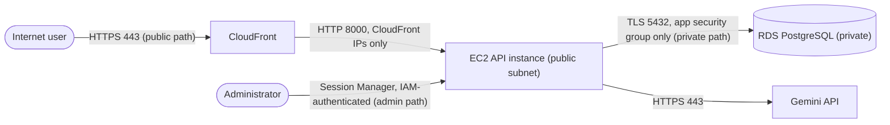

# Learn to Cloud Phase 3 Capstone: Journal API

Welcome to [Learn to Cloud's](https://learntocloud.com) Phase 3 capstone. You will be guided to building a journal API with **FastAPI**, **PostgreSQL**, structured logging, input validation, and AI-powered entry analysis.

## Capstone

These chapters will guide you and are meant to be completed in order. Each chapter builds on the previous one, so do not skip ahead. 

1. [Check the prerequisites](docs/01-prerequisites.md)
2. [Set up the project](docs/02-project-setup.md)
3. [Run the API](docs/03-run-the-api.md)
4. [Build GET for one entry](docs/04-get-entry.md)
5. [Build DELETE for one entry](docs/05-delete-entry.md)
6. [Add input validation and debug a partial update](docs/06-input-validation.md)
7. [Use logs to understand the API](docs/07-logging.md)
8. [Set up an AI provider](docs/08-ai-setup.md)
9. [Build AI-powered analysis](docs/09-ai-analysis.md)
10. [Finish the capstone](docs/10-finish.md)

**[Start the capstone →](docs/01-prerequisites.md)**

## Reference

This is additional reference material for the capstone in case you want to explore further or need help:

- [Testing and CI](docs/reference/testing-and-ci.md)
- [Troubleshooting](docs/reference/troubleshooting.md)
- [Sync your fork with upstream](docs/reference/upstream-sync.md)
- [Explore your database](docs/reference/explore-database.md)

> **Learning environment only:** This application has no authentication or
> per-user data isolation. Do not expose it publicly or store personal or
> sensitive journal content in it.

## License

MIT License - see [LICENSE](LICENSE).

## Phase 4 Capstone: Secure Cloud Deployment (AWS, eu-north-1)

**Public API:** https://d8wxgz3mcqe8i.cloudfront.net
The Journal API has no user authentication or data isolation, so only test data is used.

### Architecture

### Services chosen

| Layer | Service | Why |
|---|---|---|
| Front door | CloudFront (default `*.cloudfront.net` certificate) | Trusted HTTPS without owning a domain |
| App tier | EC2 running uvicorn as a `systemd` service under a dedicated `journalapp` user | Restarts on crash and at boot |
| Database | RDS PostgreSQL (`databasecapstone`), not publicly accessible | Private tier |
| AI | Gemini API through Google's OpenAI-compatible endpoint | Free tier |
| Admin access | AWS Systems Manager Session Manager | No SSH or open management port |
| Cost control | AWS Budgets | Alert before overspending |

### Access controls

- **Database:** only the app's security group can reach port 5432. The app connects as `journal_app`, which has no superuser, create-database or create-role attributes, no `CREATE` on schema `public`, and only `SELECT/INSERT/UPDATE/DELETE` on `entries`. Tables are owned by the admin user, and `CONNECT` on `career_journal` is revoked from `PUBLIC`. Connections use TLS.
- **Secrets:** the database URL and API key live in `/etc/journal-api.env` (root-owned, mode 600), loaded by `systemd`. They are not in the repo.
- **Admin:** Session Manager only. No SSH key and no inbound port 22.

### AI model and safety controls

- **Model:** `gemini-flash-lite-latest` (an alias that Google can repoint; verified 26 Oct 2026). API key authentication.
- **Endpoint:** Chat Completions on Google's compatibility endpoint. The course specifies the Responses API, but `POST /v1beta/openai/responses` returned 404 with a valid key and model on 26 Oct 2026, so `llm_service.py` was switched to Chat Completions (on branch gemini-chat-completions).
- **Timeout and retries:** 60 s total and 5 s connect timeout, one SDK retry. Failures propagate with no fallback analysis.
- **Safety:** the prompt tells the model to treat entry text as data, never as instructions. Output must match a strict JSON schema with `sentiment` limited to three values. Refusals, incomplete and blank responses are rejected, and the result is validated by `AnalysisResponse`. Error logs record entry id, error type and code location, not entry text.
- **Limits and cost:** Google Gemini's free tier

**Model comparison (from the API instance, small sample):**

| Model | Result |
|---|---|
| `gemini-flash-lite-latest` | 3/3 requests returned 200 in 0.57 to 0.79 s |
| `gemini-3.8-flash` | One request returned 503 after about 6 s, another got no response in 30 s, and the app logged `APITimeoutError` |

### Evidence per constraint

| # | Constraint | Evidence |
|---|---|---|
| 1 | Public HTTPS, trusted certificate | The course verifier passed on the CloudFront URL (entry creation and live analysis). Responses arrive as `HTTP/2` from CloudFront. |
| 2 | Private database | From the app instance the RDS name resolves to a private 10.x address and a TLS 1.2 connection succeeds. `\du`: `journal_app` has no attributes and no role memberships. `\dp entries`: `journal_app=arwd/postgres`. `\dn+ public`: `journal_app=U` (no CREATE). On laptop `nc -vz -w 5 <rds-endpoint> 5432` timeout; app-role `DROP TABLE` / `CREATE TABLE` denials |
| 3 | Private management, no secrets in git or logs | Admin access is via Session Manager only. Laptop timeouts on port 22 and on direct `:8000`; MFA enabled; `git log --all -p -S"AIza" --oneline` returns nothing |
| 4 | Survives restarts | Service runs under `systemd` with `Restart=always`, enabled at boot; data lives in RDS. |
| 5 | CRUD and live AI | Analysis passed the course verifier against the live model. Update and delete through the public URL |

### Limitation I would fix before pushing to production

**Model availability.** On the free tier, `gemini-3.8-flash` stalled or returned 503 while the lighter model answered in under a second. The verifier makes one unretried call with a 30 s limit, so a transient failure fails the request. For production I would use a paid tier or a second-model fallback, plus a hard application timeout shorter than the front door's 30 s limit so failures return quickly. Smaller gaps: CloudFront reaches the instance over plain HTTP (a custom origin secret header and encryption on that hop would help), and secrets sit in a root-only file instead of Secrets Manager.

### Cleanup

EC2 and RDS are stopped between work sessions and kept for Phase 5. Billing dashboard are also checked for any unexpected charges.